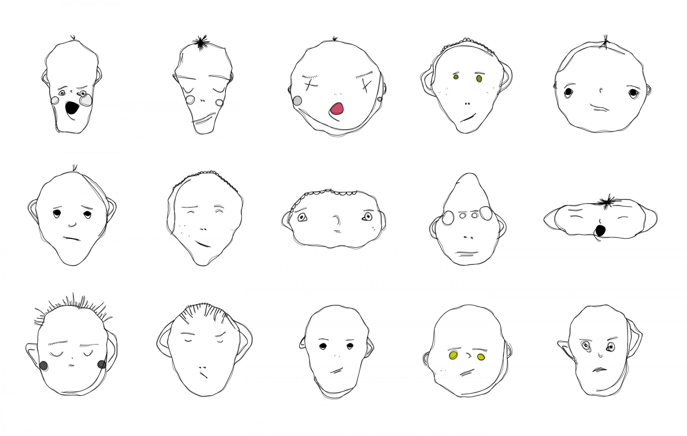
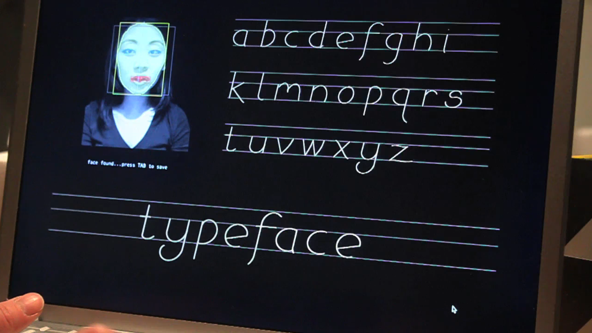

# Session 5: Examples & References
## Parameter Spaces
A generator describes more than one possible outcome. Its parameters, ranges and relationships determine which outcomes are available. Use these references to look at families of work, not only individual images.

While browsing, ask: **What stays fixed? What can change? Which combinations are possible, and which are excluded?** The suggested experiments are starting points. They are not additional assignments to complete one by one.

## Max Bill: variations on a theme


_[Max Bill, Fifteen Variations on One Theme, 1935-1938](https://www.mercedes-benz.art/en/artwork/quinze-variations-sur-un-meme-theme-15-variations-on-one-theme-max-bill-1935-38-2/)._

Bill's series explores a shared geometric construction through a theme and fifteen variations. The collection documentation describes a progression between equilateral polygons while retaining the side length. This is not a software parameter study, but it is a useful reference for asking how different works can share an underlying construction.

### Look for
- a common structure across different images
- changes in emphasis, colour and the visibility of the construction
- decisions that preserve the family without making every member look identical

### Try this
Choose a simple construction and make three interpretations of it. Keep the relationships between its parts, but change what is emphasised. Then distinguish a parameter change from a change to the drawing rule itself. Both are useful, but they are not necessarily the same operation.

> **What needs to remain for the variation to still belong to the theme?**

### References
- [Mercedes-Benz Art Collection - Fifteen Variations on One Theme](https://www.mercedes-benz.art/en/artwork/quinze-variations-sur-un-meme-theme-15-variations-on-one-theme-max-bill-1935-38-2/)
- [Museum Haus Konstruktiv - Quinze variations sur un même thème](https://www.hauskonstruktiv.ch/en/collection/quinze-variations-sur-un-meme-theme)

## Generative Design: revisit the controls
The examples in _Generative Design / Generative Gestaltung_ can be read again with a different question. In Sessions 2 and 4 we looked at how a grid or agent works. Here we look at **which controls define its possible variations**.

### P_2_1_1_01: independent controls and a fixed layout
This sketch draws diagonal marks on a grid. Horizontal and vertical mouse movement control the stroke weights of the two diagonal directions. Keyboard choices change the stroke cap. Clicking changes the random layout.

There are several kinds of control here: numerical ranges, discrete choices and a seed. The code resets `randomSeed(actRandomSeed)` before drawing the grid, keeping the layout stable until a new seed is selected.

### P_2_2_6_01: a family of linked movements
The linked-pendulum example exposes `joints`, `lineLength` and `speedRelation`. Changing them affects the traces of the connected movements. Its controls also call `startDrawing()` to restart the construction after a change.

This is useful to compare with a static generator: a configuration needs a clear starting state and enough time to develop. A longer run is not automatically evidence of a better parameter setting.

### Look for
Find the values that are exposed, their permitted ranges and the code that restarts the system. Distinguish a control that changes the drawing from a control that only changes its display, such as showing or hiding the mechanism.

### Try this
Take one example and record three configurations. Change only one control first, then compare two controls together. Keep the seed or starting state fixed where possible. For a time-based example, state whether you are comparing equal duration or a completed construction.

Read the supplied project before copying individual files. Some examples use supporting libraries. Keep the original attribution and licence with reused code, and mark your changes.

### References
- [Generative Design / Generative Gestaltung](http://www.generative-gestaltung.de/2)
- [P_2_1_1_01 - stroke weights and stroke caps in a grid](https://github.com/generative-design/Code-Package-p5.js/tree/master/01_P/P_2_1_1_01)
- [P_2_2_6_01 - linked pendulums and parameter controls](https://github.com/generative-design/Code-Package-p5.js/tree/master/01_P/P_2_2_6_01)
- [Generative Design - complete p5.js code package](https://github.com/generative-design/Code-Package-p5.js)

## Matthias Dörfelt: a recognisable family


_[Matthias Dörfelt, Weird Faces, 2012-2013](https://www.mokafolio.de/works/Weird-Faces)._

Dörfelt describes _Weird Faces_ as an attempt to combine illustration with programming. The faces are produced through algorithmic rules but retain the individual character of his drawing practice.

For this session, the interesting question is how variety can coexist with a recognisable visual language. A shared style does not require identical proportions.

### Questions
What seems to vary between faces? What gives them a common character? Which relationships would you preserve in your own generator? Treat your answers as hypotheses about the work, not claims that you have recovered its original code.

### Try this
Draw three related characters before coding. Label the differences that could become parameters. Start with geometry or mark-making rather than a vague instruction such as "make it more expressive".

### References
- [Matthias Dörfelt - Weird Faces](https://www.mokafolio.de/works/Weird-Faces)
- [Faces and parametric generators](./faces.md)

## Mary Huang: TYPEFACE


_[Mary Huang, TYPEFACE, 2010](https://mary-huang.com/projects/typeface/typeface.html)._

_TYPEFACE_ translates facial dimensions into generative type design. Huang built the project using Processing and OpenCV, drawing the letters with trigonometric functions.

This gives us a different relationship: measurements can become inputs to a visual system. The face does not have to remain a face in the output. For now, explore the mapping with manually chosen values; camera tracking is not required.

### Look for
- a shared construction across several letters
- input values affecting more than one part of the output
- the tension between variation and readability

### Try this
Create one simple letter or symbol controlled by width, height and an internal gap. Make a comparison sheet. At which combinations does the symbol become difficult to recognise? Decide whether that boundary is useful or something to constrain.

### References
- [Mary Huang - TYPEFACE](https://mary-huang.com/projects/typeface/typeface.html)

## A parameter is a design decision
A program may contain many variables, but only some need to become controls. Position can be changing state inside a moving system, while a speed limit is an exposed parameter. The distinction depends on the role you give the value.

**Continuous ranges** allow gradual changes, such as width or turning strength.  
**Discrete choices** select separate options, such as a drawing mode or number of parts.  
**Linked parameters** change together according to a relationship, such as spacing expressed as a fraction of width.

These are not three exclusive boxes. A linked parameter can still have a continuous range. The useful question is how the controls work together.

## A comparison grid is a small map
A 3 × 3 sheet can compare two parameters while everything else stays fixed. For example:
```text
columns: narrow, medium, wide
rows: small gap, medium gap, large gap
fixed: colour, line weight, drawing rule
```

A different pair of parameters gives a different view of the same system. Do not assume that nine images exhaust all its possibilities. Label the values so the comparison can be read and repeated.

For a moving system, compare separate runs with the same starting conditions and elapsed duration. If mouse input matters, either hold it fixed or document the interaction. Otherwise the comparison mixes parameter changes with changes in input or history.

## Limits can reveal the system
The centre of a range is often comfortable. Its edges can reveal more. Try a very narrow shape, an unusually large spacing or a nearly motionless behaviour. Does the system become unreadable, unstable or unexpectedly interesting?

A constraint is not necessarily a correction. It decides which possibilities the generator should allow. Keep an unusual result when it supports the idea, but distinguish deliberate openness from a coding mistake.

## Presets and repeatability
A preset is a named configuration, not a separate program. Keep the parameter values beside the output. For a changing system, also record the starting state, inputs and capture time that matter.

`randomSeed()` can repeat the sequence used by `random()`. It does not preserve an image independently of the code that consumes that sequence. Reset at the start of comparable runs; resetting a moving agent's seed every frame is a different rule.

### References
- [p5.js - randomSeed()](https://p5js.org/reference/p5/randomSeed/)
- [p5.js - createSlider()](https://p5js.org/reference/p5/createSlider/)

## Questions for reading a generator
When looking at a family of outputs, ask:
- What remains fixed, and what are the actual controls?
- Which ranges and combinations are allowed?
- Are parameters independent, linked or conditional?
- Does the same setting produce the same result under the same conditions?
- Which outputs show the family clearly, and which reveal its limits?
- What would change if one control were removed?

The point is not to collect as many variations as possible. It is to understand the space you have designed and make choices within it.

→ [Faces and parametric generators](./faces.md)  
→ [Notes on this session](./teacher-notes.md)  
→ [Back to Session 5](./README.md)
