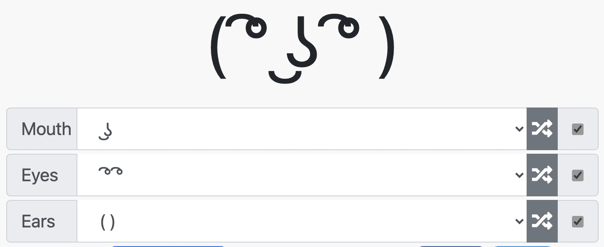
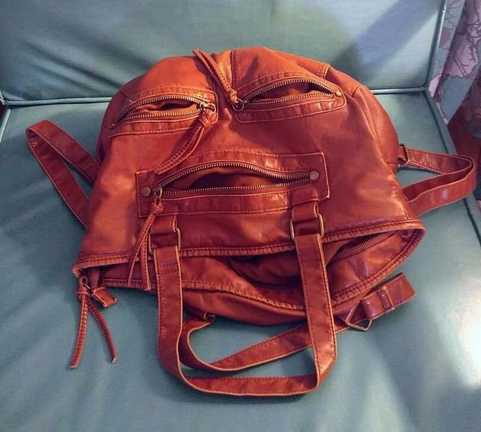
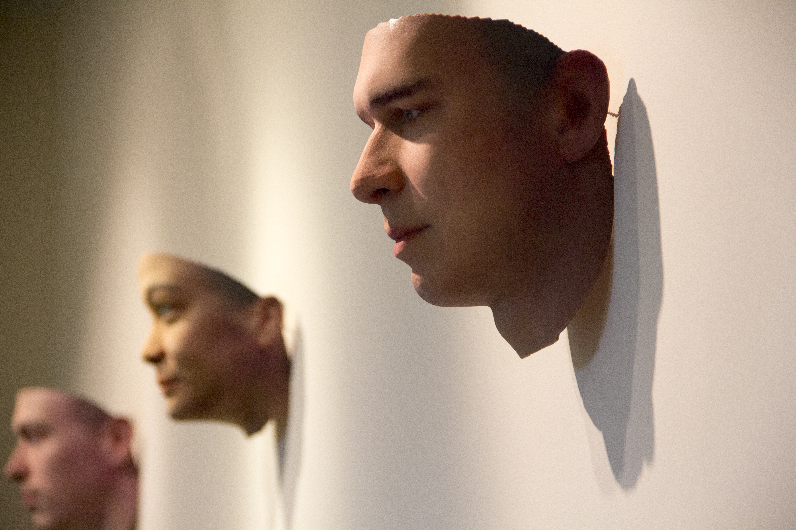
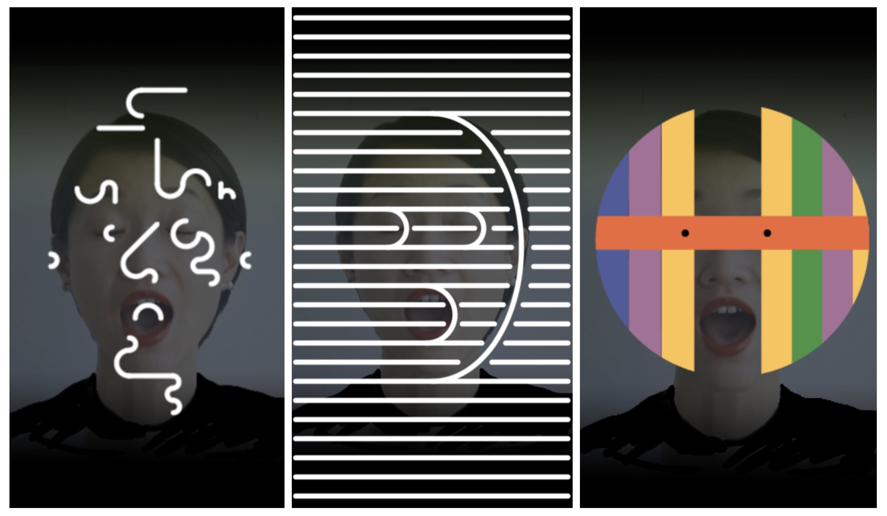
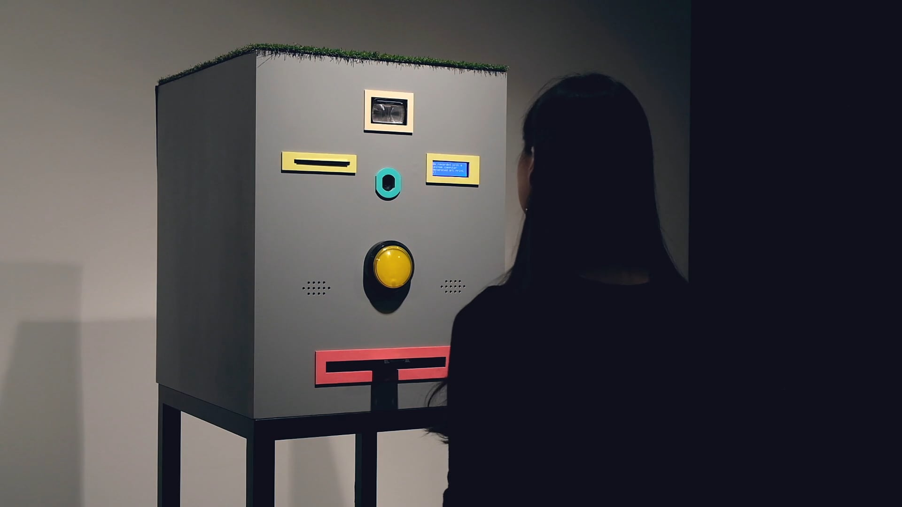
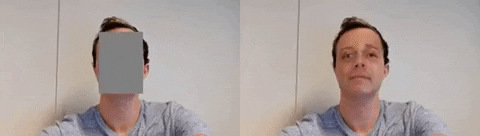
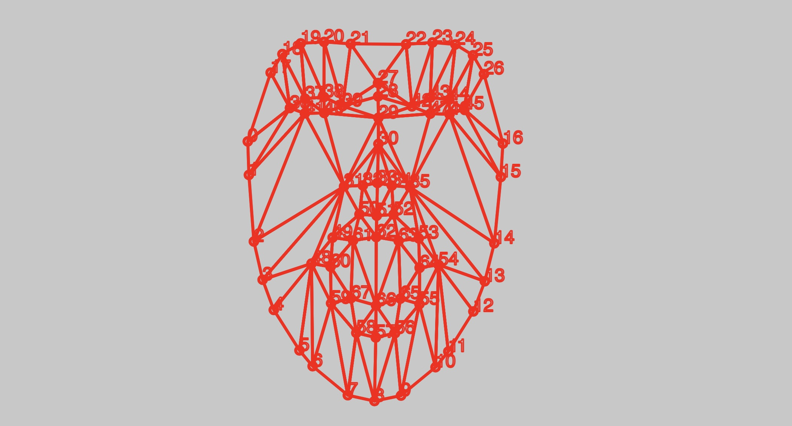

# Session 5: Faces / Parametric Generators


_[Matthias Dörfelt, Weird Faces, 2012-2013](https://www.mokafolio.de/works/Weird-Faces). Image retained from the earlier course material._

How much can a face change while it still belongs to the same family? A generator makes this question quite concrete: instead of drawing every version separately, we design the parts, relationships and variations that can produce them.

## Focus
Explore **parameters, proportions, recognition and families of outcomes** through a face or character generator. This is one possible direction within Session 5. It is not an additional compulsory project.

## Idea
Create a small system controlled by three meaningful parameters. They might change the proportions, arrangement, drawing style or choice of features. Begin with a sketch on paper or in Excalidraw and decide what should remain fixed.

A useful starting point is:
```text
head width: 80 to 160 pixels
eye spacing: 0.2 to 0.6 of the head width
eye shape: circle or rectangle
```

The numbers are starting suggestions, not a universal model of a face. Test the range and change it to fit your visual idea. Work in a simple view first; 3D, face tracking and camera input are not required.

### Consider
What is the smallest set of marks that reads as a face? Which proportions matter? Can an unusual combination remain recognisable? Does the family depend on its geometry, its line quality, or both?

### Ask
- What are the three main controls, and what does each one change?
- Which features should move together rather than independently?
- What happens at the limits of the ranges?
- Can another person recognise that different outputs belong to the same system?

## Continuous, discrete and linked
**Continuous controls** change gradually: head width, eye spacing, mouth width or a curve.  
**Discrete controls** select separate options: one or two eyes, a circular or rectangular feature, glasses present or absent.  
**Linked controls** preserve or change a relationship: eye spacing can depend on head width instead of being fixed in pixels.

A control called "mood" can affect several marks, but it is still a mapping you designed. Describe what it actually changes, such as mouth curvature and eyebrow angle. Do not treat a stylised face generator as a way to measure a real person's identity, personality or feelings.

## Build a family
Start with one recognisable version, then expose one parameter at a time. Reuse the same construction rather than drawing separate programs for each character.

Make the Session 5 comparison sheet: vary two parameters across a 3 × 3 grid and keep the others fixed. Include extreme combinations. Select three contrasting configurations and save their values with the images. These are the same deliverables as the main lesson, not another set of work.

Animation, external data and more elaborate controls can be later extensions. First make the family understandable.

## References
The collection below includes rule-based drawing, typography, interactive masks, face tracking and learned models. They are different approaches, not interchangeable technologies. The first examples support the parametric exercise directly; the later ones open questions for further exploration.

### Matthias Dörfelt: Weird Faces
The faces in _Weird Faces_ are generated through code, while keeping a drawing character connected to Dörfelt's own illustration practice. Compare several outputs rather than looking at one face alone.

Which parts seem stable? Which vary? Your interpretation can suggest a system of your own, but it is not evidence that you have recovered the original algorithm.

[Weird Faces - artist's project page](https://www.mokafolio.de/works/Weird-Faces)  
[Weird Faces Vending Machine - a related installation](https://www.mokafolio.de/works/Weird-Faces-Vending-Machine)

### Lenny Face Generator: a small vocabulary


_[Lenny Face Generator](https://lenny-face-generator.textsmilies.com/). Image from the earlier course collection._

This generator lets you combine choices for eyes, mouth and ears. It is a simple example of discrete parameters. A few reusable parts can support many combinations, and not every combination needs to look convincing.

Try defining your own tiny vocabulary before building a more elaborate character system. Which parts are interchangeable, and which combinations need a constraint?

### Pareidolia: reading a face into a pattern


_Found-face reference from the earlier course archive. The original individual image credit was not recorded; the earlier page linked to the [Pareidolia community collection](https://www.reddit.com/r/Pareidolia/)._

Faces can be suggested by very little information. Try moving two dots and one line around a rectangle. When does the arrangement begin to read as a face, and when does that reading disappear?

This is a useful design question even without a realistic head or detailed features. For a related discussion of minimal faces and masks, see [Zach Lieberman's project account](https://zachlieberman.medium.com/m%C3%A1s-que-la-cara-overview-48331a0202c0).

### Mary Huang: TYPEFACE


_[Mary Huang, TYPEFACE, 2010](https://mary-huang.com/projects/typeface/typeface.html). Image from the earlier course collection._

_TYPEFACE_ maps facial dimensions to generative letterforms. Huang describes a system made in Processing and OpenCV, with letters drawn using trigonometric functions.

The interesting connection is not that a face must produce another face. Measurements can control a different visual language. Try the idea with manually selected dimensions before adding any tracking technology.

## Further directions: input, interpretation and identity
These works are references to discuss, not software to install for this session. They extend the question from "what can my parameters generate?" to "where do the values come from, and what do we assume they mean?"

### Heather Dewey-Hagborg: Stranger Visions


_[Heather Dewey-Hagborg, Stranger Visions](https://deweyhagborg.com/projects/stranger-visions). Image from the earlier course collection._

Dewey-Hagborg used genetic material from discarded objects to generate speculative portrait sculptures. The artist frames the work as a critique of biological surveillance and genetic determinism, and discusses limitations and bias in DNA phenotyping.

These are not verified reconstructions of the people who left the material. For this course, the question is how a convincing image can make an uncertain mapping appear authoritative. What does the system actually know, and what has it filled in?

### YesYesNo / Zach Lieberman: Más Que la Cara


_[Más Que la Cara - project account by Zach Lieberman](https://zachlieberman.medium.com/m%C3%A1s-que-la-cara-overview-48331a0202c0). Image from the earlier course collection._

The installation turns tracked facial movement into changing graphic masks. The project account also documents sketches, physical mask workshops and the development of its visual language.

This is useful for looking at the relationship between a changing input and a designed set of responses. Which parts of the mask follow the face, and which are choices made by the designers?

### Matthias Dörfelt: Face Trade


_[Face Trade - artist statement in the ISEA archive](https://www.isea-symposium-archives.org/art-events/face-trade-by-matthias-dorfelt/). Image from the earlier course collection._

_Face Trade_ exchanges a generated drawing for a photograph of the participant. The artist statement describes the photograph being stored on the Ethereum blockchain as part of that transaction.

The generator is now part of a social exchange. What does the participant receive, and what do they give away? A playful interface can still have consequences beyond the image it produces.

### Matthew Plummer-Fernandez: drawing and recognition
<iframe src="https://player.vimeo.com/video/69694262?h=edd986e6e2" title="Drawing faces instructed by facial recognition" width="100%" height="400" style="aspect-ratio:16 / 9; border:0;" allow="fullscreen; picture-in-picture" allowfullscreen></iframe>

[Watch Drawing faces instructed by facial recognition - Matthew Plummer-Fernandez](https://vimeo.com/69694262)

Use this earlier reference to discuss the relationship between making a drawing and having it interpreted by a recognition system. Does the drawing satisfy a person, a detector, or both? The video link remains available as a fallback where the embedded player is not shown.

### DeepPrivacy: generated replacements


_[DeepPrivacy - Håkon Hukkelås, Rudolf Mester and Frank Lindseth](https://github.com/hukkelas/DeepPrivacy). Demonstration retained from the earlier course collection._

DeepPrivacy is a research project that uses a generative adversarial network for face anonymisation. It is a useful contrast with a small generator whose geometry we define directly: here a learned model produces replacement imagery.

Treat this as a research reference, not a guarantee that replacing a face removes every identifying detail from an image. What is preserved, what is replaced, and what information might remain outside the face?

### Kyle McDonald and Arturo Castro: Face Substitution
<iframe src="https://player.vimeo.com/video/29348533?h=5c0cc36b58&title=0&byline=0&portrait=0" title="Face Substitution by Kyle McDonald and Arturo Castro" width="100%" height="400" style="aspect-ratio:16 / 9; border:0;" allow="fullscreen; picture-in-picture" allowfullscreen></iframe>

[Watch Face Substitution - Kyle McDonald and Arturo Castro](https://vimeo.com/29348533)

This real-time face-substitution experiment is an earlier example of tracking and image replacement. It should not be confused with generating a face from our own geometric parameters, or with every later technique described as AI face generation.

Ask what changes when a replacement follows a person's movement. Which information carries the expression, and which gives the replacement its appearance?

## An earlier p5.js starting point


[MediaPipe Face Mesh in p5.js - earlier course sketch](https://editor.p5js.org/guma/sketches/IAlxLpyRd)

This is retained as an optional historical example, not a required starter for Session 5. Its browser permissions and dependencies need checking before it is used in a current project. Begin with manually chosen parameters; there is no need to solve face tracking in order to make a face generator.

If an experiment later uses camera input, work with consent and do not publish or upload another person's image without their agreement.

## Keep exploring
The earlier collection also included these references. They remain here for browsing rather than as extra requirements:
- [Additional visual reference from the previous edition - Instagram](https://www.instagram.com/p/CUqCDq8Jpff/) (may require sign-in; individual attribution was not recorded)
- [FaceShift experiments by Kyle McDonald - CreativeApplications](https://www.creativeapplications.net/sound/faceshift-studio-experiments-by-kyle-mcdonald/)
- [Scramble Suit face tracking - CreativeApplications](https://www.creativeapplications.net/openframeworks/scramble-suit-face-tracking-openframeworks/)
- [Generative Design - p5.js code package](https://github.com/generative-design/Code-Package-p5.js)
- [p5.js - createSlider()](https://p5js.org/reference/p5/createSlider/)
- [p5.js - map()](https://p5js.org/reference/p5/map/)

## What belongs to your system?
Compare several outputs and ask what remains recognisable. Keep the parameter values with the selected images, and distinguish the rules you wrote from references, borrowed code, feedback and AI assistance.

The goal is not to model every possible face. It is to make a small family whose possibilities and limitations you understand.

→ [Back to Session 5](./README.md)  
→ [Examples and references](./examples.md)  
→ [Notes on this session](./teacher-notes.md)
