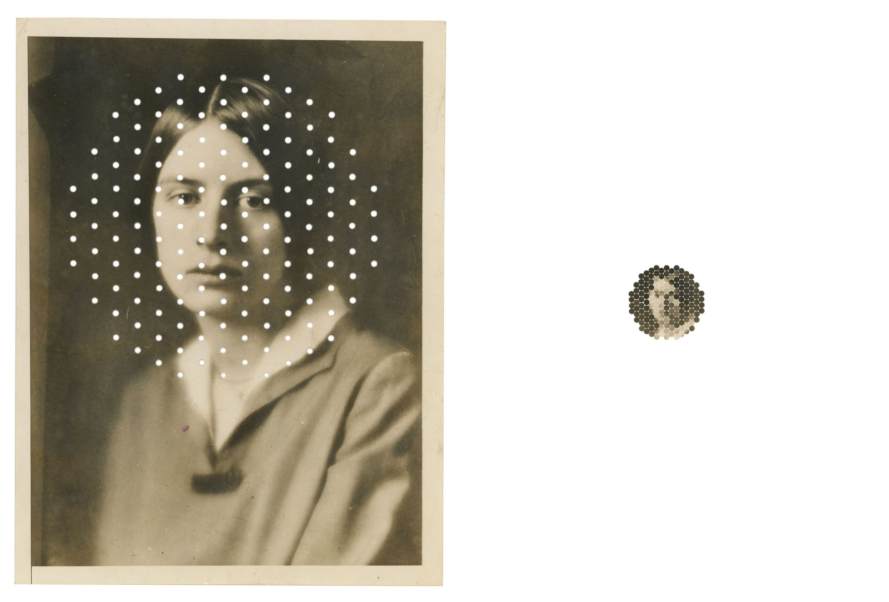
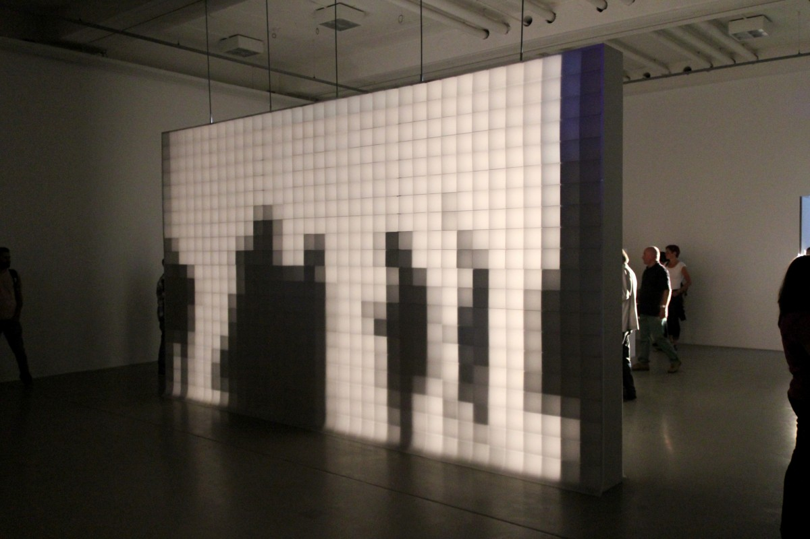
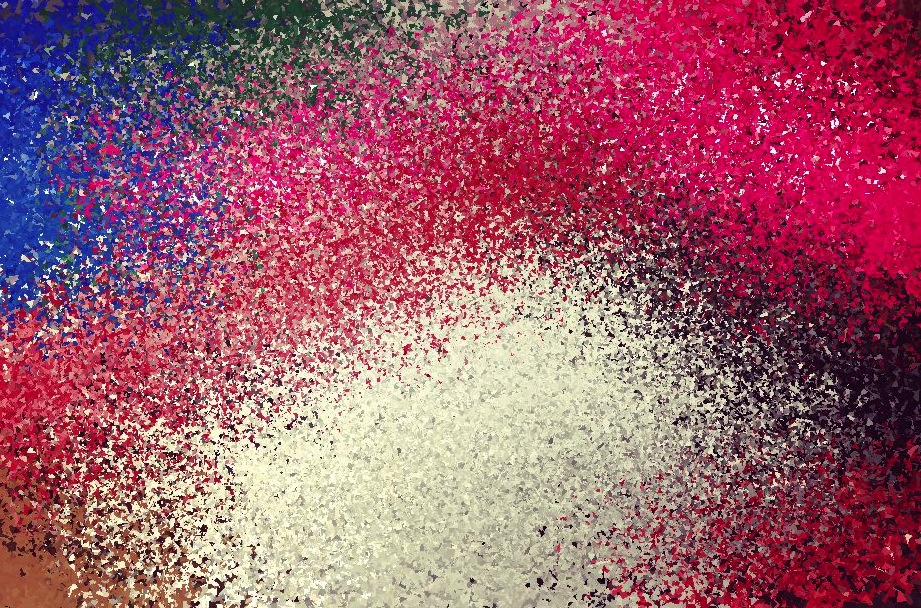
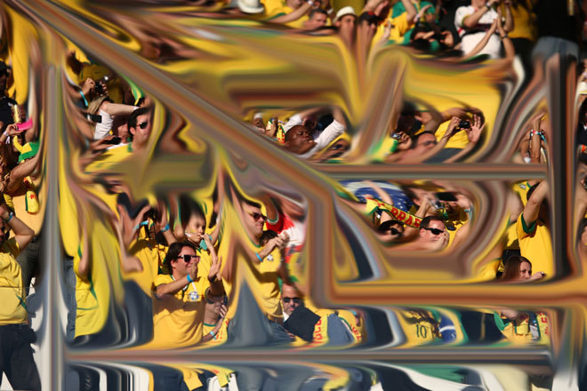
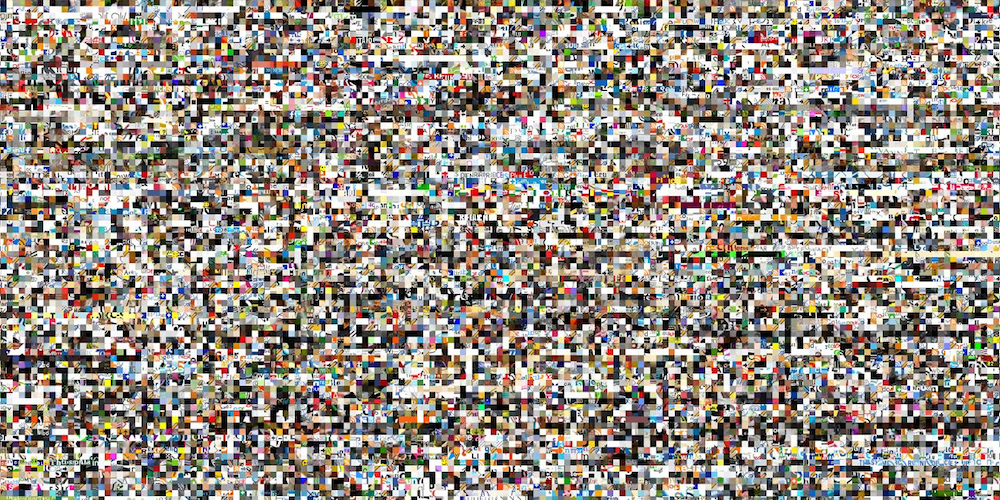

# Session 6: Examples & References
## Images as Data
An image has colours, positions and relationships that can become material for another system. We can sample it, rearrange it, translate it into marks or let it guide a behaviour. The image does not have to remain a picture of the same thing.

While browsing, ask: **What is being read? What is being changed? What remains from the source?** These examples open different directions. The small experiments are suggestions, not a separate assignment for every reference.

## Kensuke Koike: rearrangement before code


_[Kensuke Koike - photographic transformation](https://twitter.com/k_koi/status/1344428323049504769)._

Koike's image transformations are a useful place to begin without a computer. In the related series _No More, No Less_, made with Thomas Sauvin, photographs are cut and rearranged under a particular constraint: no material is added or removed. Koike describes this process in his interview with LensCulture.

We can use that idea to separate changing the material from changing its arrangement. The same pieces can form a very different image.

### Look for
- parts that move while keeping their original content
- relationships broken by cutting, folding or exchanging pieces
- recognition surviving an unexpected arrangement

### Try this
Cut a copy of an image into a few strips. Rearrange all the strips without adding another image. Then describe the operation as a rule that could be repeated with a different source. Does it depend on the subject, or only on the positions of the pieces?

### References
- [Kensuke Koike - Nothing Added, Nothing Removed, interview](https://www.lensculture.com/articles/kensuke-koike-nothing-added-nothing-removed)
- [Kensuke Koike and Thomas Sauvin - No More, No Less, project and collaboration](https://www.lensculture.com/articles/kensuke-koike-and-thomas-sauvin-the-necessity-of-collaboration-in-kensuke-koike-and-thomas-sauvin-s-no-more-no-less)

## Aram Bartholl: a pixel can be physical


_[Aram Bartholl, 0,16, 2009-2013](https://arambartholl.com/016/)._

_0,16_ turns shadows into a low-resolution image using light, square frames and layers of translucent paper. The arrangement makes pixelation tangible without using a conventional digital screen. Its title refers to the installation's resolution of 0.16 pixels per inch.

The reference is useful because a sampled value and the physical element displaying it are not the same thing. In our sketches, a sample can become a square, a circle, a line or something else.

### Questions
How much information is enough to recognise the shadow? What changes with viewing distance? Which part of the effect comes from the grid, and which comes from the display material?

### Try this
Reconstruct the same image at three sampling distances. Keep the drawing rule fixed. Look at the results close up and from farther away, then change the shape used to display each sample.

### References
- [Aram Bartholl - 0,16, project documentation and video](https://arambartholl.com/016/)

## Generative Design P_4: translate samples into marks
The image examples in _Generative Design / Generative Gestaltung_ connect this session directly to code. **P_4_3_1_01** is a particularly useful starting point: the same source image is represented through several drawing modes.

Mode 1 maps a greyscale estimate to line weight. Mode 3 changes line length. Mode 4 combines rotation, length and weight. Mode 6 keeps the sampled colour while changing the size of a circular mark. These are different mappings, not different source photographs.

The useful structure is: **sample → extract a value → map it → draw a module**. The module can be one you developed in Session 5.

### Look for
Find where the colour is read, where a greyscale value is calculated, and where that value reaches the drawing commands. Also notice which values come from mouse input rather than from the image.

### Try this
Compare two modes with the same image. Describe the difference without using the word "effect". Then keep one mode and use another source. Which part of the visual character belongs to the mapping?

Start with the supplied project rather than copying an isolated file: it uses supporting files and a p5.js 1.x-style `preload()` setup. The lesson's starter uses p5.js 2.x image loading. Keep attribution and licence information with any code you reuse, and mark your changes.

### References
- [Generative Design - image examples and code gallery](http://www.generative-gestaltung.de/2)
- [P_4_3_1_01 - pixel mapping project](https://github.com/generative-design/Code-Package-p5.js/tree/master/01_P/P_4_3_1_01)
- [P_4_3_1_01 - read the drawing modes](https://github.com/generative-design/Code-Package-p5.js/blob/master/01_P/P_4_3_1_01/sketch.js)
- [Generative Design - complete p5.js code package](https://github.com/generative-design/Code-Package-p5.js)

## Matthieu Savary: Pixel is Data


_[Matthieu Savary, Pixel is Data](https://apps.apple.com/us/app/pixel-is-data/id622378844)._

_Pixel is Data_ treats a photograph as information that can be interpreted using different parameters, rather than assuming its original arrangement is the only useful one. The project description asks what happens when pixels no longer need to behave like little squares in photographic order.

This is a useful continuation of Parameter Spaces: the input image changes, but so do the controls that organise its information. There is no need to install the app for this exercise.

### Questions
What happens if colours remain but their original positions disappear? What still connects the result to the source? Is photographic resemblance the only way an image can be readable?

### Try this
Read a small row of colour samples. Draw it once in its original order and once ordered from dark to light. Keep each sample's RGB values together. Compare what is preserved with what is lost.

### References
- [Matthieu Savary - Pixel is Data, project description](https://apps.apple.com/us/app/pixel-is-data/id622378844)
- [Matthieu Savary - Pixel is Data in Data-Driven Graphic Design](https://smallab.co/log/data-driven-graphic-design-book-andrew-richardson-bloomsbury-2016/)

## Kim Asendorf: sorting and collecting pixels


_[Kim Asendorf - image study](https://kimasendorf.tumblr.com/post/93793575666)._

Asendorf's _ASDF Pixel Sort_ code selects portions of rows and columns using thresholds, then sorts their pixel values. The threshold determines where a transformation starts and stops. This is different from replacing every sample with a new shape.

Sorting can look like an error, but the change can follow an explicit rule. Ask which boundaries in the source remain visible, and which parts have been reorganised.

### Try this
Begin with a single row of samples, not a whole photograph. Compare sorting all of it with sorting only a selected interval. Change the interval before adding more operations. The shared ASDF implementation is written for Processing, not directly for p5.js.

### 100.000.000 Stolen Pixels


_[Kim Asendorf, 100.000.000 Stolen Pixels, 2010](https://kimasendorf.com/100000000/)._

For this project, a crawler collected 10 × 10-pixel fragments from one million images. The project offers different arrangements of the resulting collection. The unit is now a fragment from another image, not only one colour sample.

What does a fragment keep of its source? What disappears when fragments become a large collection? For your own experiment, use a small set of images you are allowed to work with rather than copying the collection method.

### References
- [Kim Asendorf - ASDF Pixel Sort, source code](https://github.com/kimasendorf/ASDFPixelSort)
- [Kim Asendorf - 100.000.000 Stolen Pixels](https://kimasendorf.com/100000000/)
- [The Coding Train - Pixels, including pixel sorting](https://thecodingtrain.com/tracks/pixels)

## HYBE: IRIS
<iframe src="https://player.vimeo.com/video/50200308" title="IRIS by HYBE" width="100%" style="aspect-ratio:16 / 9; border:0;" loading="lazy" allow="fullscreen; picture-in-picture" allowfullscreen></iframe>

_[Watch HYBE, IRIS, 2012](https://vimeo.com/50200308)._

_IRIS_ uses a matrix of monochrome liquid-crystal elements. Circular segments open and close to control transmitted ambient light, rather than emitting the light themselves. The individual display element becomes part of the visual language.

This opens another question: we can change the way a sample is displayed without changing where it was sampled.

### Look for
The relation between an element's opening, its apparent lightness and the larger image. Look at the movement too: the transition between values can become part of the work.

### Try this
Keep the sampling grid, but represent each value with a circle, a short line or a rotating bar. What changes when size controls the light-dark impression instead of fill colour?

### References
- [HYBE - IRIS, official video and project description](https://vimeo.com/50200308)
- [HYBE - Addendum to IRIS](https://vimeo.com/50599869)

## Four different operations
It helps to name what the system does rather than describe everything as a filter.

**Sampling:** choose which positions to read. Fewer samples leave more of the source unmeasured.  
**Mapping:** turn a sampled value into another property, such as colour into size or angle.  
**Rearrangement:** move samples or fragments while keeping some of their contents.  
**Accumulation:** let successive marks build an image over time.

These can be combined, but start with one. Keeping a diagram of the operation makes the comparison easier to read.

## Going further: read the pixel array
For a small static sketch, `img.get(x, y)` is a clear starting point. For many samples, you can read the pixel array directly. At an image pixel density of 1, each pixel occupies four consecutive entries: red, green, blue and alpha. Rows are stored one after another.

After the image has loaded and been resized, this can replace `drawSamples()` in the main lesson. It uses the same `img` and positive whole-number `sampleStep`, and reconstructs the coloured-square baseline:

```js
function drawSamples() {
  img.pixelDensity(1);
  img.loadPixels();
  background(255);
  noStroke();

  for (let y = 0; y < img.height; y += sampleStep) {
    for (let x = 0; x < img.width; x += sampleStep) {
      const index = 4 * (y * img.width + x);
      const r = img.pixels[index];
      const g = img.pixels[index + 1];
      const b = img.pixels[index + 2];
      fill(r, g, b);
      rect(x, y, min(sampleStep, img.width - x), min(sampleStep, img.height - y));
    }
  }
}
```

Call `loadPixels()` before reading, not for every sample. This code reads an opaque image and draws onto a separate canvas, so it does not need `img.updatePixels()`. That method is needed when you change entries in the image's pixel array and want those changes applied to the image.

Keep source and output separate while learning. Reading from the canvas you are also changing introduces a different, feedback-based process.

### References
- [p5.js - image get()](https://p5js.org/reference/p5.Image/get/)
- [p5.js - image pixels](https://p5js.org/reference/p5.Image/pixels/)
- [p5.js - image pixelDensity()](https://p5js.org/reference/p5.Image/pixelDensity/)
- [p5.js - image loadPixels()](https://p5js.org/reference/p5.Image/loadPixels/)
- [p5.js - image updatePixels()](https://p5js.org/reference/p5.Image/updatePixels/)

## Further directions
Once a still-image mapping is clear, the same questions can be extended to a moving source, another coordinate system or an agent that samples the image as it travels. These are optional directions, not extra requirements for Session 6.

- [Camera pixels in p5.js - course sketch](https://codepen.io/gu-ma/pen/LggyKa)
- [The Coding Train - Pixels tutorials](https://thecodingtrain.com/tracks/pixels)
- [Generative Design - P_4_3_1_01 in the p5.js editor](https://editor.p5js.org/generative-design/sketches/P_4_3_1_01)
- [fyprocessing - pixel experiments](https://fyprocessing.tumblr.com/search/pixels)

Camera input adds permissions and consent questions as well as technical work. Begin with still images; do not publish or upload another person's image without their agreement.

## Questions for reading an image-based system
When you look at a transformation, ask:
- What comes from the source, and what is decided by the program?
- Which positions are sampled, and what values are extracted?
- Are original colours, spatial relationships or fragments preserved?
- What changes when the same rule receives a different image?
- Does the program read an unchanged source or respond to its own output?
- What would someone need to repeat this transformation?

An image that becomes difficult to recognise has not necessarily failed. The question is whether the change follows an idea you can explain.

→ [Notes on this session](./teacher-notes.md)  
→ [Back to Session 6](./README.md)
