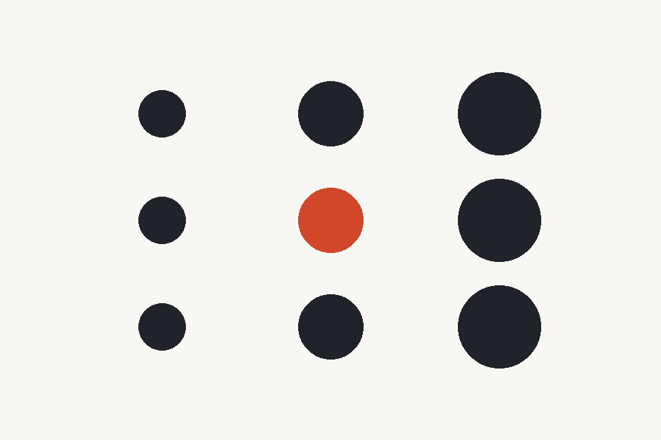

# Session 7: Generative Media

> Until now, we have written the rules of our systems. What changes when a model becomes part of the process?

In Session 6 we read image data and decided how to transform it. Here we will give an image to a generative model and investigate what it preserves, changes or invents.

We will work with **still images** and use the **Replicate web interface**. No API integration, model training or new p5.js code is required today.

**source → intention → generation → comparison → selection**

## 🟢 OPEN

AI is now part of the creative material, not only an assistant for writing code. You can use it to generate and transform images, but you should still make deliberate decisions about the inputs, experiments and selection.

The main question is: **Who made the important decisions, and where did they happen?**

## What we will explore

By the end of this session, you should be able to:

- distinguish a generative model from the explicit rules written in p5.js
- explain the difference between generating from text and transforming a supplied image
- use a source image and a clear instruction to investigate what a model changes
- compare a small series by keeping important conditions consistent
- identify what a model preserves, adds, removes or misunderstands
- select a result for a reason, including deciding not to use one

→ [Examples and references](./examples.md)

## 1. Look before generating

We will begin with a short shared demonstration. Start with [this shared PNG composition](./images/shared-composition.png): a 3 × 3 grid of nine circles. Their centres form a regular grid, their sizes increase from left to right, and the middle circle has a different colour. The circles do not overlap. Download the PNG and upload that file directly into Replicate. Everyone can use the same source for our first comparison.

Before running the model, describe the image as a set of relationships:

- How many circles are there? Does the model preserve the count?
- Do their centres still form a 3 × 3 grid?
- Do the circles still get larger from left to right?
- Does the centre circle keep its contrasting colour?
- Where is the empty space?
- Which parts should stay recognisable?

Then imagine changing only its **material appearance**. Perhaps the same structure is made of cut paper, woven thread or ceramic.

Write two short statements:

**Keep:** nine circles, the grid, the size progression, the empty spaces and the contrasting centre.  
**Change:** the apparent material and surface.

Compare your prediction with what the model actually does.

## 2. Open a model in Replicate

For the first investigation, use the [FLUX.2 Klein 4B playground](https://replicate.com/black-forest-labs/flux-2-klein-4b). This is a compact open-source model that supports image editing. We choose it because we can inspect the input image, prompt and settings, not because it is supposed to make the most beautiful image.

1. Open the model's web page and sign in if needed.
2. Add the source image under **Images**.
3. Write an instruction describing both what to preserve and what to change.
4. Where available, match the source image's aspect ratio.
5. Keep the output resolution and other settings consistent across runs.
6. Generate, download the result and note the settings.

For example:

> Use the attached geometric composition as the layout. Keep the number of shapes, their positions and the empty spaces. Reinterpret the marks as pieces of cut black paper on a light background. Do not introduce new objects.

The model may not follow every instruction. That is part of what we are investigating.

For the second row, we can compare with [FLUX 3 Image](https://replicate.com/black-forest-labs/flux-3-image), a different, proprietary model. It also accepts reference images, but it does not expose exactly the same controls. Turn **Grounding** off for a self-contained comparison.

There is no need to learn every field in the interface.

## 3. Start a small series

Now choose **one source image of your own**, such as a pattern, drawing-machine output, parameter study or image transformation from an earlier session.

Choose three clearly different treatments, for example:

- cut paper
- woven thread
- glazed ceramic

Use the **same source image each time**. Do not feed the previous generated result into the next run.

For each treatment, decide what should stay fixed. Your prompts can be short, but they should describe a specific transformation rather than only a style.

### The six-image study

Compare two models across the three treatments:

| | Cut paper | Woven thread | Glazed ceramic |
| --- | --- | --- | --- |
| **Model A** | A1 | A2 | A3 |
| **Model B** | B1 | B2 | B3 |

Start with the same image and equivalent instructions for both models. Keep output dimensions and other relevant settings comparable where possible, and note differences you cannot control.

The six images are **a small experiment**, not a ranking of which model is universally better.

If only one model is available, make the second row with a second, clearly labelled instruction strategy. For example, compare a minimal instruction with a more constrained one. Do not pretend those two rows are different models.

If access or budget is limited, begin with the three Model A results and compare the second row together using the shared demonstration.

## 4. Compare what actually happened

Put the source and results next to each other. Look across a row, then down a column.

Ask:

- Which parts of the composition survived?
- Were new objects, textures or shadows added?
- Did the spacing or number of elements change?
- Where did the model ignore the instruction?
- Which differences come from the requested treatment?
- Which seem to come from the model itself?
- Which result is visually appealing but misses the idea?

Keep one result you would continue with and **one you would reject**. Explain both decisions.

A model changing something you wanted to preserve is not automatically a failure of the exercise. It tells us something about the relationship between your intention and the model's behaviour.

## 5. Keep the experiment readable

Record the model name, source, instruction and any settings that matter.

If a model offers a seed, use or record it when comparing versions **within that model**. The same number is not a shared visual starting point across different models, and not every model exposes seed controls.

Save your files locally rather than assuming the prediction page will always be available. An image generated through the web interface may remain in your Replicate history until you delete it.

Use your own images or material you have permission to upload. Do not upload private photographs or someone else's work without considering the rights, consent and data retention involved.

## 6. Discuss the decisions

Show your series to a partner. Explain what you tried to preserve before revealing which images you prefer.

Your partner should identify one surprising change, then ask why the model may have produced it. This is not about guessing the model's hidden reasoning, but comparing what went in and what came out.

A useful final question:

> **Would I have made the same decision if the model had given me a less polished result?**

## What to keep for your journal

Keep one connected record:

- the original image and what you wanted to preserve or change
- the six-image comparison (or the smaller series you managed to run)
- the model names, prompts and relevant settings
- one selected and one rejected image, each with a short explanation
- something the model added, removed or misunderstood
- a possible direction for the next session

No full prompt history or polished essay is needed.

## Next session

Session 8, **Hybrid Pipelines**, will investigate ways to connect images, code and generative models. One possible direction is:

**generated image → describe its rules → rebuild a simple version in p5.js → change the code → transform the new output with a model**

A starting image might contain only two circles or a small grid. The point is not to recover an original program hidden inside it, but to invent an understandable one that lets us make further decisions.

Today is about learning to work with the model as material. We will decide the technical setup and exact activity for Session 8 separately.

→ [Examples and references](./examples.md)  
→ [Notes on this session](./teacher-notes.md)
