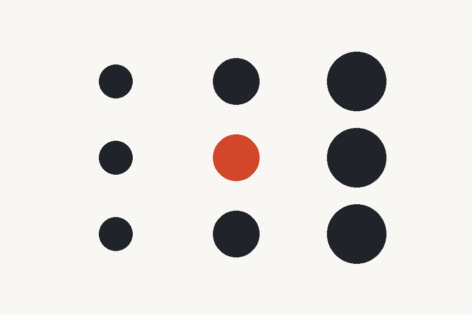

# Session 7: Generative Media

> Until now, we have written the rules of our systems. What changes when a model becomes part of the process?

In Session 6 we read image data and decided how to transform it. Here we will give an image to a generative model and investigate what it preserves, changes or invents.

We will work with **still images** and use the **Replicate web interface**. No API integration, model training or new p5.js code is required today.

**source → intention → generation → comparison → selection**

## 🟢 OPEN

AI is now part of the creative material, not only an assistant for writing code. You can use it to generate and transform images, but you should still make deliberate decisions about the inputs, experiments and selection.

The main question is: **Who made the important decisions, and where did they happen?**

## What we will explore

By the end of this session, you should be able to:

- distinguish a generative model from the explicit rules written in p5.js
- explain the difference between generating from text and transforming a supplied image
- use a source image and a clear instruction to investigate what a model changes
- compare a small series by keeping important conditions consistent
- identify what a model preserves, adds, removes or misunderstands
- select a result for a reason, including deciding not to use one

→ [Examples and references](./examples.md)

## 1. Write a prompt before generating

We will begin with the same image so we can compare what different models do with it.

[Download the shared PNG](./images/shared-composition.png). It shows nine circles in a 3 × 3 grid. The circles get larger from left to right, and the centre circle has a contrasting colour.

**Work individually. Before opening Replicate:**

1. Look at the image and decide **what to keep**, such as the grid, nine circles, size progression or contrasting centre.
2. Decide **what to change**. For example, give the circles the appearance of woven thread, cut paper or ceramic.
3. Write a short prompt telling the model both what to keep and what to change.
4. Predict one thing the model might change even though you asked it not to.

For example:

> Use the attached image as the layout. Turn the nine circles into woven-thread objects. Keep the 3 × 3 grid, size progression, contrasting centre and empty spaces. Do not add extra objects.

Keep your first prompt and prediction. **Do not generate anything yet.** You will test them in the next step.

## 2. Test your prompt in Replicate

Open the [FLUX.2 Klein 4B playground](https://replicate.com/black-forest-labs/flux-2-klein-4b). It can generate from text alone or edit an image you supply. Here we will **edit an existing image**.

1. Open the model page and sign in if needed.
2. Upload the **shared PNG from Step 1** under **Images**.
3. Paste **the prompt you wrote in Step 1** into the prompt field. You can adapt the example if needed.
4. Set the aspect ratio to **match_input_image**, if available, and leave the other settings at their defaults for this first test.
5. Click **Run**, then download your result.

Compare the result with the original. **What stayed the same? What changed? Did your prediction come true?** Write down one observation.

One generation is enough for now. In the next step you will develop your own series.

For the second-model comparison in Step 3, use [FLUX 3 Image](https://replicate.com/black-forest-labs/flux-3-image). It supports image editing too, but offers different controls. Turn **Grounding** off so the model does not introduce web search.

There is no need to learn every field in the interface today.

## 3. Make a small series

Choose **one image of your own**, perhaps a pattern, drawing-machine output, parameter study or image transformation from an earlier session. If you don't have a suitable image, you can continue with the shared PNG.

Decide what should stay fixed in that image. Then choose **three different treatments**, for example:

- cut paper
- woven thread
- glazed ceramic

Write three related prompts that preserve the same features but change the requested material.

**Make a six-image comparison:**

1. With **Model A: [FLUX.2 Klein 4B](https://replicate.com/black-forest-labs/flux-2-klein-4b)**, run all three prompts. Save the outputs as A1, A2 and A3.
2. With **Model B: [FLUX 3 Image](https://replicate.com/black-forest-labs/flux-3-image)**, run the **same three prompts**. Save them as B1, B2 and B3. Turn **Grounding** off.
3. Put the six results in a grid:

| | Cut paper | Woven thread | Glazed ceramic |
| --- | --- | --- | --- |
| **Model A: Klein** | A1 | A2 | A3 |
| **Model B: FLUX 3** | B1 | B2 | B3 |

**Start every run from the same original image**, not the previous generated result. Keep relevant settings comparable where possible, and note important differences between the models.

If only one model is available, compare three **short prompts** with three **more specific prompts** for the same treatments. Label the rows by instruction strategy, not by model. If access or budget is limited, three carefully compared results are enough.

The point is to test one idea through a series, not to produce unrelated pictures or rank models.

## 4. Compare and choose

Place your source image next to the results. Compare **across a row** to see how the material changes the outcome, and **down a column** to see what each model does with the same instruction.

Ask:

- Which parts of the original composition survived?
- Did the model add objects, textures, shadows or other details?
- Did the number, spacing or arrangement of elements change?
- Which result follows your intention most closely?
- Which is attractive but does something you did not ask for?

Choose **one result to continue with** and **one to reject or develop differently**. Write a short reason for each. An unexpected result is useful evidence, even if you don't want to keep it.

## 5. Save the experiment

For each result, keep the **source image, model name, prompt and relevant settings** together. Label the comparison so another person can tell what changed.

If the model offers a seed, record it when useful for repeating a run **within the same model**. The same seed is not a guarantee of comparable results across different models.

Download your outputs rather than assuming they will stay available online. Replicate retains web-interface predictions until you delete them.

Use your own images or material you have permission to upload. Avoid private photographs or images of other people without their agreement.

## 6. Reflect on your decisions

Review the series **individually**. In a few sentences, explain what you tried to preserve, what the model changed or invented, and why you selected one result and rejected another.

We can share a few findings with the class, but the experiments and journal reflections are individual work.

Consider:

> **Would I have made the same decision if the model had given me a less polished result?**

## What to keep for your journal

Keep one connected record:

- the original image and what you wanted to preserve or change
- the six-image comparison (or the smaller series you managed to run)
- the model names, prompts and relevant settings
- one selected and one rejected image, each with a short explanation
- something the model added, removed or misunderstood
- one possible direction you might explore next

No full prompt history or polished essay is needed.

## Next session

Session 8, **Hybrid Pipelines**, will investigate ways to connect images, code and generative models. One possible direction is:

**generated image → describe its rules → rebuild a simple version in p5.js → change the code → transform the new output with a model**

A starting image might contain only two circles or a small grid. The point is not to recover an original program hidden inside it, but to invent an understandable one that lets us make further decisions.

Today is about learning to work with the model as material. We will decide the technical setup and exact activity for Session 8 separately.

→ [Examples and references](./examples.md)  
→ [Notes on this session](./teacher-notes.md)
